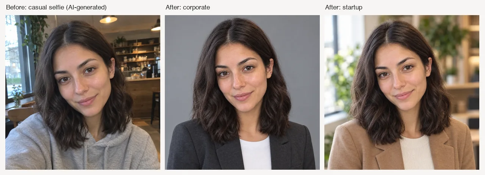

# AI Headshot Generator Skill

[English](./README.md) | [简体中文](./README.zh-CN.md) | 日本語

> 👉 こちらもどうぞ [Photo to Anime Skill](https://github.com/beatra-ai/photo-to-anime-skill)

日常のセルフィーを、新しい背景、ビジネス向けの服装、スタジオライティングのプロフィール写真に変換。履歴書、会社サイト、キャリアプロフィール、SNS 向け。Claude Code、Cursor、Codex、Windsurf、Cline、OpenClaw のどれからでもそのまま使えます。

> [!IMPORTANT]
> 生成には [Beatra](https://beatra.ai?utm_source=github&utm_medium=flagship&utm_campaign=ai-headshot-generator-skill) アカウントが必要で、クレジットを消費します。スキル自体のインストールは無料です。

| 項目 | 内容 |
| --- | --- |
| **できること** | 日常のセルフィーを、新しい背景、プロフェッショナルな服装、スタジオライティングを備えたスタジオ品質のプロフェッショナルヘッドショットに変換。LinkedIn、履歴書、企業ウェブサイト、SNSに対応。 |
| **モデル** | Qwen Image 2.0 Fast、MiniMax H3 Image、Qwen Image 3.0、Qwen Image 3.0 Pro、Wan Image 2.7 Fast、Qwen Image 2.0 Pro、Wan Image 2.7 Pro、GPT Image 2.5 Flare、GPT Image 2.5 Sunburst、GPT Image 2 |
| **動作要件** | Python 3.10 以上と、`SKILL.md` を読み込めるエージェント |
| **費用** | インストールは無料。生成のたびに Beatra アカウントのクレジットを消費しますが、課金されるのは、その生成を明示的に依頼したとき、または確認カードを承認したときだけです。 |
| **対応エージェント** | Claude Code、Cursor、Codex、Windsurf、Cline、OpenClaw |

<p align="center"></p>

*カフェで撮った架空の女性のセルフィー（デモ用に AI 生成）と、そこから作ったコーポレート向けとスタートアップ向けのプロフィール写真。顔と髪は同じまま。Beatra AI で生成。*

| Skill | Entry point | Version |
| --- | --- | --- |
| [`ai-headshot-studio`](skills/ai-headshot-studio) | [SKILL.md](skills/ai-headshot-studio/SKILL.md) | 0.2.5 |

このリポジトリは [beatra-ai/beatra-skills](https://github.com/beatra-ai/beatra-skills/tree/main/skills/ai-headshot-studio) から自動的に公開されています。問題の報告はそちらへお願いします。

このスキルは `ai-headshot-generator` としても知られています（インストール名：`ai-headshot-studio`）。

## インストール

[`skills`](https://skills.sh) CLI を使う場合：

```bash
npx skills add beatra-ai/ai-headshot-generator-skill
```

Claude Code プラグインとして：

```bash
claude plugin marketplace add beatra-ai/ai-headshot-generator-skill
claude plugin install ai-headshot-studio@ai-headshot-generator-skill
```

Codex プラグインとして：

```bash
codex plugin marketplace add beatra-ai/ai-headshot-generator-skill
codex plugin add ai-headshot-studio@ai-headshot-generator-skill
```

GitHub Copilot CLI プラグインとして：

```bash
copilot plugin marketplace add beatra-ai/ai-headshot-generator-skill
copilot plugin install ai-headshot-studio@ai-headshot-generator-skill
```

Gemini CLI 拡張機能として：

```bash
gemini extensions install https://github.com/beatra-ai/ai-headshot-generator-skill
```

Antigravity CLI プラグインとして：

```bash
agy plugin install https://github.com/beatra-ai/ai-headshot-generator-skill
```

GitHub CLI を使う場合：

```bash
gh skill install beatra-ai/ai-headshot-generator-skill ai-headshot-studio
```

または、このリポジトリをクローンして `skills/ai-headshot-studio` を次の場所にコピーします：Claude Code は `~/.claude/skills/`、Cursor は `~/.cursor/skills/`、Codex は `~/.agents/skills/`、Windsurf は `~/.codeium/windsurf/skills/`、Cline は `~/.cline/skills/`、OpenClaw は `~/.openclaw/skills/`。

または、次の文をエージェントに貼り付けてください：

```text
https://github.com/beatra-ai/ai-headshot-generator-skill から ai-headshot-studio スキル（フォルダ skills/ai-headshot-studio）をインストールし、その SKILL.md に従って私の Beatra アカウントに接続してください。
```

クリーン環境で動作確認済み：Antigravity CLI (2026-11-09)。

## 入力と出力

| | 種類 | 形式 | 仕様 |
| --- | --- | --- | --- |
| **入力** | 画像：日常のセルフィーまたは人物写真と、任意の背景参考画像 | JPG、PNG、WEBP | — |
| **出力** | 画像：スタジオ品質のヘッドショット | PNG | 1 リクエストにつき 1 枚／2K／アスペクト比 1:1、3:4、4:5 |

## 技術仕様と出力上限

2026-11-14 時点。最新の一覧：https://docs.beatra.ai/ja/docs/models

- **アップロード** — 1 ファイルあたり最大 100 MB。下記の各モデルの入力制限も適用されます
- **画像から画像** — 10 モデル（Qwen Image 2.0 Fast、MiniMax H3 Image、Qwen Image 3.0、Qwen Image 3.0 Pro、Wan Image 2.7 Fast、Qwen Image 2.0 Pro、Wan Image 2.7 Pro、GPT Image 2.5 Flare、GPT Image 2.5 Sunburst、GPT Image 2）／PNG／1 リクエストあたり最大 4 枚／キャンバス最大 16.8 MP
  - 16.8 MP（4K ティア）：MiniMax H3 Image（1 リクエストあたり最大 4 枚）／GPT Image 2.5 Flare、GPT Image 2.5 Sunburst、GPT Image 2（1 リクエストにつき 1 枚）
  - 入力画像：1 リクエストあたり最大 4 枚、各 10〜20 MB／BMP、GIF、JPEG、PNG、TIFF、WEBP
- **画像編集** — 7 モデル（Qwen Image 2.0 Fast、MiniMax H3 Image、Qwen Image 3.0、Qwen Image 3.0 Pro、Wan Image 2.7 Fast、Qwen Image 2.0 Pro、Wan Image 2.7 Pro）／PNG／1 リクエストあたり最大 4 枚／キャンバス最大 16.8 MP
  - 16.8 MP（4K ティア）：MiniMax H3 Image（1 リクエストあたり最大 4 枚）
  - 入力画像：1 リクエストあたり最大 4 枚、各 10〜20 MB／BMP、GIF、JPEG、PNG、TIFF、WEBP

## 得られるもの

- **業界別スタイリング** — コーポレートにはスーツとネイビー背景、テクノロジーにはスマートカジュアルとモダンオフィス、医療には白衣とクリーンな背景。ヘッドショットがあなたの職業のビジュアル言語に合わせて調整されます。
- **アイデンティティ維持変換** — 人物の顔の形、肌のトーン、瞳の色、髪は変換後も認識可能なまま、背景、服装、ライティングがスタジオ品質にアップグレードされます。
- **プラットフォーム対応フォーマット** — LinkedInの円形クロップに対応した顔中心の正方形1:1出力、または履歴書や印刷用のポートレート形式。あらゆるプロフェッショナル用途にすぐ使用可能。

## 活用シーン

- **コーポレート・金融ヘッドショット** — テーラードスーツ、ソリッドなネイビーまたは白い背景、自信に満ちた表情のクラシックなスタジオライティング。エグゼクティブプロフィールや投資家資料に最適。
- **テクノロジー・スタートアップポートレート** — スマートカジュアルな服装、モダンオフィスまたはソフトグレーの背景、明るく自然なライティングと親しみやすい表情。チームページやピッチ資料に。
- **アカデミック・医療ヘッドショット** — フォーマルまたは臨床的なスタイリング、ニュートラルな背景と均一なソフトライティング。教員名鑑、研究プロフィール、医療リスティングに。
- **クリエイティブ業界ポートレート** — アーティスティックなスタイリング、スタジオバックドロップ、ディレクショナルリムライト、個性を表現。デザインポートフォリオや個人ブランディングに。

## よくある質問

### 日常のセルフィーをLinkedInのヘッドショットにできますか？

はい。セルフィーをアップロードし、コーポレートまたはテクノロジースタイルを選ぶと、クリーンな背景、プロフェッショナルな服装、スタジオライティングを備えた洗練されたヘッドショットに変換されます。LinkedInの円形クロップに最適化。

### 自分の顔はどう使われますか？

ヘッドショットはセルフィーをもとに生成します。顔の形、肌のトーン、瞳の色、髪はセルフィーを参考にし、背景、服装、ライティングを新しく作ります。

### 特定の背景やオフィスシーンを使えますか？

はい。セルフィーを1枚目、背景の参考画像を2枚目としてアップロードすると、その環境を背景にしたヘッドショットを作ります。

### 完成したヘッドショットのライティングや背景を直せますか？

はい。そのヘッドショットをアップロードし、ライティングを明るく、背景をなめらかに、露出を整えるなど調整内容を伝えると、その部分だけを編集します。

## 更新とセキュリティ

2026 年 10 月のリリース以降、このスキルに自動更新機能はありません。インストールしたファイルだけを実行し、
自動的に置き換えることはありません。更新はインストールに使ったツール（`npx skills update ai-headshot-studio` または
`gh skill update ai-headshot-studio`）で行ってください。詳細はスキル内の `references/updates-and-security.md` を参照してください。

## ライセンス

このリポジトリのスキルファイル（`SKILL.md`、リファレンス、スクリプト）とこの README は [MIT-0](LICENSE) で提供しています。商用を含め、自由に使用・改変・再配布でき、クレジット表記は不要です。

生成は Beatra のクラウドサービスで行われ、[Beatra 利用規約](https://beatra.ai/terms?utm_source=github&utm_medium=flagship&utm_campaign=ai-headshot-generator-skill)が適用されます。

## リンク

- スキルページ — https://beatra.ai/skills/ai-headshot-studio?utm_source=github&utm_medium=flagship&utm_campaign=ai-headshot-generator-skill
- ウェブサイト — https://beatra.ai?utm_source=github&utm_medium=flagship&utm_campaign=ai-headshot-generator-skill
- ドキュメント — https://docs.beatra.ai?utm_source=github&utm_medium=flagship&utm_campaign=ai-headshot-generator-skill
- コンソール — https://console.beatra.ai
- AI エージェント向け — https://beatra.ai/llms.txt （インデックス）· https://beatra.ai/llms-full.txt （全スキルを 1 ファイルに）
