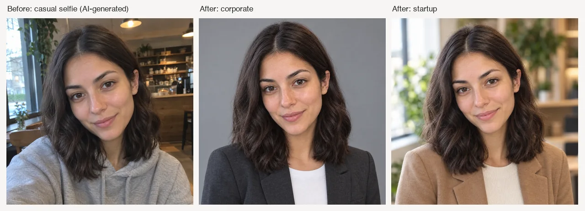

# AI Headshot Generator Skill

English | [简体中文](./README.zh-CN.md) | [日本語](./README.ja.md)

> 👉 See also [Photo to Anime Skill](https://github.com/beatra-ai/photo-to-anime-skill)

Turn a casual selfie into a professional headshot with a new background, business attire, and studio lighting for resumes, company websites, career profiles, and social media, from inside Claude Code, Cursor, Codex, Windsurf, Cline, or OpenClaw.

> [!IMPORTANT]
> Rendering needs a [Beatra](https://beatra.ai?utm_source=github&utm_medium=flagship&utm_campaign=ai-headshot-generator-skill) account and uses credits. The skill itself is free to install.

| Question | Answer |
| --- | --- |
| **What it does** | Turn a casual selfie into a studio-quality professional headshot with new backgrounds, professional attire, and studio lighting for LinkedIn, resume, company website, and social media. |
| **Models** | Qwen Image 2.0 Fast, MiniMax H3 Image, Qwen Image 3.0, Qwen Image 3.0 Pro, Wan Image 2.7 Fast, Qwen Image 2.0 Pro, Wan Image 2.7 Pro, GPT Image 2.5 Flare, GPT Image 2.5 Sunburst, GPT Image 2 |
| **Requirements** | Python 3.10+ and an agent that loads `SKILL.md` |
| **Cost** | Free to install. Each render uses credits on your Beatra account, and paid steps run only when you ask for that exact render or approve its card. |
| **Works with** | Claude Code, Cursor, Codex, Windsurf, Cline, OpenClaw |

<p align="center"></p>

*A casual cafe selfie of a fictional woman (itself AI-generated for this demo) beside a corporate headshot and a startup headshot made from it, with her face and hair kept the same. AI-generated with Beatra.*

| Skill | Entry point | Version |
| --- | --- | --- |
| [`ai-headshot-studio`](skills/ai-headshot-studio) | [SKILL.md](skills/ai-headshot-studio/SKILL.md) | 0.2.5 |

This repository is published automatically from [beatra-ai/beatra-skills](https://github.com/beatra-ai/beatra-skills/tree/main/skills/ai-headshot-studio). Report issues there.

Also known as `ai-headshot-generator` (installed under the Beatra slug `ai-headshot-studio`).

## Install

With the [`skills`](https://skills.sh) CLI:

```bash
npx skills add beatra-ai/ai-headshot-generator-skill
```

As a Claude Code plugin:

```bash
claude plugin marketplace add beatra-ai/ai-headshot-generator-skill
claude plugin install ai-headshot-studio@ai-headshot-generator-skill
```

As a Codex plugin:

```bash
codex plugin marketplace add beatra-ai/ai-headshot-generator-skill
codex plugin add ai-headshot-studio@ai-headshot-generator-skill
```

As a GitHub Copilot CLI plugin:

```bash
copilot plugin marketplace add beatra-ai/ai-headshot-generator-skill
copilot plugin install ai-headshot-studio@ai-headshot-generator-skill
```

As a Gemini CLI extension:

```bash
gemini extensions install https://github.com/beatra-ai/ai-headshot-generator-skill
```

As an Antigravity CLI plugin:

```bash
agy plugin install https://github.com/beatra-ai/ai-headshot-generator-skill
```

With the GitHub CLI:

```bash
gh skill install beatra-ai/ai-headshot-generator-skill ai-headshot-studio
```

Or clone this repository and copy `skills/ai-headshot-studio` into `~/.claude/skills/` for Claude Code,
`~/.cursor/skills/` for Cursor, `~/.agents/skills/` for Codex, `~/.codeium/windsurf/skills/` for Windsurf,
`~/.cline/skills/` for Cline, or `~/.openclaw/skills/` for OpenClaw.

Or paste this into your agent:

```text
Install the ai-headshot-studio skill from https://github.com/beatra-ai/ai-headshot-generator-skill (folder skills/ai-headshot-studio), then follow its SKILL.md to connect my Beatra account.
```

Tested in clean-room CI: Antigravity CLI (2026-11-09).

## Inputs and outputs

| | Type | Formats | Specifications |
| --- | --- | --- | --- |
| **Input** | Image — Casual selfie or portrait photo, plus an optional background reference | JPG, PNG, WEBP | — |
| **Output** | Image — Studio-style professional headshot | PNG | 1 image per request; 2K; aspect ratios 1:1, 3:4, 4:5 |

## Technical Specifications & Output Limits

As of 2026-11-14. Live list: https://docs.beatra.ai/en/docs/models

- **Uploads** — up to 100 MB per file; the per-model input limits below also apply
- **Image to image** — 10 models (Qwen Image 2.0 Fast, MiniMax H3 Image, Qwen Image 3.0, Qwen Image 3.0 Pro, Wan Image 2.7 Fast, Qwen Image 2.0 Pro, Wan Image 2.7 Pro, GPT Image 2.5 Flare, GPT Image 2.5 Sunburst, GPT Image 2); PNG; up to 4 images per request; canvas up to 16.8 MP
  - 16.8 MP (4K tier): MiniMax H3 Image (up to 4 images per request); GPT Image 2.5 Flare, GPT Image 2.5 Sunburst, GPT Image 2 (1 image per request)
  - Input images: up to 4 per request, 10–20 MB each; BMP, GIF, JPEG, PNG, TIFF, WEBP
- **Image editing** — 7 models (Qwen Image 2.0 Fast, MiniMax H3 Image, Qwen Image 3.0, Qwen Image 3.0 Pro, Wan Image 2.7 Fast, Qwen Image 2.0 Pro, Wan Image 2.7 Pro); PNG; up to 4 images per request; canvas up to 16.8 MP
  - 16.8 MP (4K tier): MiniMax H3 Image (up to 4 images per request)
  - Input images: up to 4 per request, 10–20 MB each; BMP, GIF, JPEG, PNG, TIFF, WEBP

## Why use Beatra instead of calling model APIs directly

- **One account for every model this skill uses** — Image to image 10; Image editing 7 (Qwen Image 2.0 Fast, MiniMax H3 Image, Qwen Image 3.0, Qwen Image 3.0 Pro, Wan Image 2.7 Fast, Qwen Image 2.0 Pro, Wan Image 2.7 Pro, GPT Image 2.5 Flare, GPT Image 2.5 Sunburst, GPT Image 2) (as of 2026-11-14), behind one Beatra sign-in; no keys from individual model providers to manage.
- **You decide what gets paid for** — Paid renders run only when you ask for that exact render or approve its card, which shows the live credit estimate.
- **Direction before rendering** — the skill plans, directs, and reviews the work, then renders it on Beatra.
- **Files you can verify** — every file under `skills/` matches the release archive on cdn.beatra.ai byte for byte, checked by SHA-256 before each push.
- **Updates you control** — no self-updater; update with the tool you installed it with.
- **Runs in your agent** — Claude Code, Cursor, Codex, Windsurf, Cline, OpenClaw.

## What you get

- **Industry-aware styling** — Corporate gets a suit and navy background, tech gets smart casual and modern office, medical gets a white coat and clinical backdrop. The headshot matches the visual language of your profession.
- **Identity-preserving transformation** — The person's face shape, skin tone, eye color, and hair remain recognizable while the background, attire, and lighting are upgraded to studio quality.
- **Platform-ready formats** — Square 1:1 output with the face centered for LinkedIn circular crops, or portrait format for resume and print—ready to use on every professional surface.

## Use cases

- **Corporate and finance headshots** — Tailored suit, solid navy or white background, classic studio lighting with a confident neutral expression—perfect for executive profiles and investor decks.
- **Tech and startup portraits** — Smart casual attire, modern office or soft gray background, bright natural-feeling lighting with an approachable expression for team pages and pitch materials.
- **Academic and medical headshots** — Formal or clinical styling with neutral backgrounds and even soft lighting for faculty directories, research profiles, and healthcare listings.
- **Creative industry portraits** — Artistic styling with studio backdrops, directional rim lighting, and individual personality for design portfolios and personal branding.

## FAQ

### Can I turn a casual selfie into a LinkedIn headshot?

Yes. Upload your selfie, choose the corporate or tech style, and the tool transforms it into a polished professional headshot with a clean background, professional attire, and studio lighting—optimized for the LinkedIn circular crop.

### How is my face used?

The headshot is generated from your selfie: your face shape, skin tone, eye color, and hair guide the result, while the background, attire, and lighting are new.

### Can I use a specific background or office setting?

Yes. Upload your selfie as the first image and a background reference as the second, and the headshot is set in that environment.

### Can I fix the lighting or background on a finished headshot?

Yes. Upload the headshot and describe the adjustment, such as brighter lighting, a smoother background, or balanced exposure; the edit changes only that part.

## Updates and security

Since the 2026-10 release, this skill contains no self-updater: it runs only the
files you installed and never replaces them on its own. Update it with the tool
you installed it with — `npx skills update ai-headshot-studio` or `gh skill update ai-headshot-studio`.
Details: `references/updates-and-security.md` inside the skill.

## License

The skill files in this repository (`SKILL.md`, references, and scripts) and this README are licensed under
[MIT-0](LICENSE): free to use, modify, and redistribute, including commercially, with no attribution required.

Media generation runs on Beatra's cloud service under the [Beatra Terms of Service](https://beatra.ai/terms?utm_source=github&utm_medium=flagship&utm_campaign=ai-headshot-generator-skill).

## Links

- Skill page — https://beatra.ai/skills/ai-headshot-studio?utm_source=github&utm_medium=flagship&utm_campaign=ai-headshot-generator-skill
- Website — https://beatra.ai?utm_source=github&utm_medium=flagship&utm_campaign=ai-headshot-generator-skill
- Docs — https://docs.beatra.ai?utm_source=github&utm_medium=flagship&utm_campaign=ai-headshot-generator-skill
- Console — https://console.beatra.ai
- For AI agents — https://beatra.ai/llms.txt (index) · https://beatra.ai/llms-full.txt (every skill in one file)
