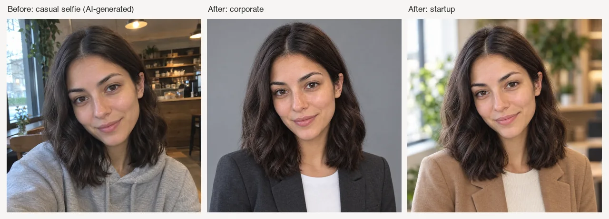

# AI Headshot Generator Skill

[English](./README.md) | 简体中文

把一张日常自拍变成专业形象照，换上新背景、职业着装和影棚光效，适用于职场社交主页、简历、公司官网和社交媒体，在 Claude Code、Codex 或 OpenClaw 里直接完成。

> [!IMPORTANT]
> 生成需要 [Beatra](https://beatra.ai) 账号并消耗积分，安装本身不收费。

| 问题 | 回答 |
| --- | --- |
| **能做什么** | 将一张日常自拍转化为影棚级专业形象照，搭配全新背景、职业着装和影棚光效，适用于 LinkedIn、简历、公司官网和社交媒体。 |
| **运行要求** | Python 3.10+，以及能加载 `SKILL.md` 的 Agent |
| **费用** | 安装免费。每次生成消耗 Beatra 账号积分，只有你明确要求这次生成或批准确认卡后才会付费。 |
| **支持的 Agent** | Claude Code、Codex、OpenClaw |

<p align="center"></p>

*一位虚构女性在咖啡馆的随手自拍（这张自拍本身也是为演示 AI 生成的），与据此生成的正装职业照和创业公司风格职业照并排，面部与发型保持一致。由 Beatra AI 生成。*

| Skill | Entry point | Version |
| --- | --- | --- |
| [`ai-headshot-studio`](skills/ai-headshot-studio) | [SKILL.md](skills/ai-headshot-studio/SKILL.md) | 0.1.4 |

本仓库由 [beatra-ai/beatra-skills](https://github.com/beatra-ai/beatra-skills/tree/main/skills/ai-headshot-studio) 自动发布，问题请到那里反馈。

## 安装

使用 [`skills`](https://skills.sh) CLI：

```bash
npx skills add beatra-ai/ai-headshot-generator-skill
```

使用 GitHub CLI：

```bash
gh skill install beatra-ai/ai-headshot-generator-skill ai-headshot-studio
```

也可以克隆本仓库，把 `skills/ai-headshot-studio` 复制到 `~/.claude/skills/`（Claude Code）、`~/.agents/skills/`（Codex）或 `~/.openclaw/skills/`（OpenClaw）。

或者把下面这段话发给你的 Agent：

```text
从 https://github.com/beatra-ai/ai-headshot-generator-skill 安装 ai-headshot-studio skill（目录 skills/ai-headshot-studio），然后按它的 SKILL.md 连接我的 Beatra 账号。
```

## 你能得到什么

- **按行业匹配风格** — 企业金融搭配西装和深色背景，科技公司搭配商务休闲和现代办公，医疗行业搭配白大褂和干净背景。形象照自动匹配你的行业视觉语言。
- **保持人物身份** — 人物的脸型、肤色、瞳色和发型在变换后依然清晰可辨，背景、着装和光效升级到影棚级别。
- **适配平台格式** — 方形 1:1 输出，面部居中以适配 LinkedIn 圆形裁剪，也可输出竖版用于简历和印刷——每个专业场景都能直接使用。

## 适用场景

- **企业金融形象照** — 西装革履，纯色深色或白色背景，经典影棚光效搭配自信沉稳的表情——适合高管主页和投资人材料。
- **科技创业人像** — 商务休闲着装，现代办公或柔和灰色背景，明亮自然光效搭配亲切表情——适合团队页面和路演材料。
- **学术医疗证件照** — 正式或临床着装，中性背景搭配均匀柔和光效——适合教师名录、科研主页和医疗平台展示。
- **创意行业人像** — 艺术造型搭配影棚背景、侧逆光和个性表达——适合设计师作品集和个人品牌形象。

## 常见问题

### 能把日常自拍变成 LinkedIn 形象照吗？

可以。上传自拍，选择企业或科技风格，工具会将其转化为精致的专业形象照——干净背景、职业着装和影棚光效，专为 LinkedIn 圆形裁剪优化。

### 生成后还会像本人吗？

会的。变换保持你的脸型、肤色、瞳色和发型，同时升级背景、着装和光效。结果是一张影棚级形象照，依然清晰可辨是你本人。

### 能用指定的背景或办公场景吗？

可以。把自拍作为第一张图上传，背景参考作为第二张图。工具会将你放入该职业场景中，同时保持你的身份特征。

### 能修复已认可形象照的光效或背景吗？

可以。上传已认可的形象照，描述需要的调整——提亮光效、平滑背景或均衡曝光——编辑只针对该方面，不改变你的身份或整体构图。

## 更新

安装后的 skill 每天最多检查一次新版本，替换前先校验官方归档，任何一步失败都不会动你已安装的版本。
随时可以关闭，见 skill 内的 `references/automatic-updates-and-safety.md`。

## 许可证

[MIT-0](LICENSE)：可自由使用、修改和再分发，包括商用，无需署名；与这些 skill 在 ClawHub 上的条款一致。
